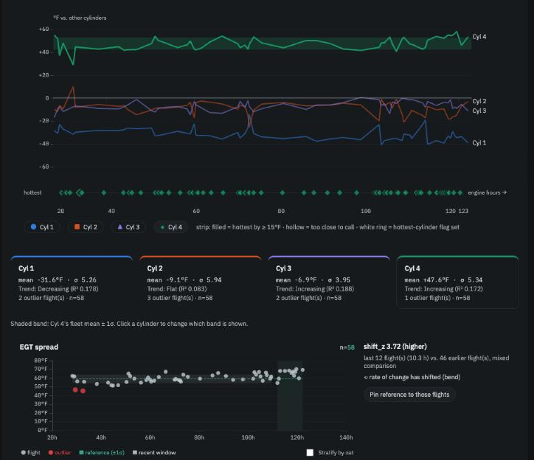

# Cylinder balance

**In brief.** On a FADEC engine the four cylinders should behave as a matched set, so the most telling single picture of engine health is how their cruise exhaust temperatures sit relative to one another — and whether that picture is changing. The app watches it two ways: the **spread** from hottest to coolest, and each cylinder's **deviation** from the other three. On Trends they are drawn together as one *Cylinder balance* panel: four lines that, on a healthy engine, run roughly flat and parallel.

## Why EGT pattern, not EGT level

The exhaust gas temperature of one cylinder on one flight depends on power, altitude, outside air and the day. The *pattern* across the four cylinders depends on the cylinders. Because the engine computer gives each cylinder the fuel and spark it intends, a cylinder that drifts away from its neighbours is telling you about an injector, a plug, an ignition coil or the probe itself — not about how the engine was leaned, because it wasn't.

Most engines have a cylinder that always runs hottest. On a turbocharged 915iS or 916iS it is usually cylinder 4, nearest the turbo exhaust. That is normal, and the app learns which cylinder is *your* usual hottest rather than assuming a flat ideal.

## Two measurements

**Spread** — hottest cruise EGT minus coolest — is the one-number summary, and the one the Operators Manual limits (392 °F between cylinders at normal fuel flow). The app compares each flight's spread with your usual spread in similar outside air temperature and watches for a widening trend over engine hours.

**Deviation** — each cylinder's cruise EGT minus the average of the other three — is the diagnostic version. It tells you *which* cylinder moved and in *which direction*. A cylinder running hotter than its own usual can mean a lean injector; cooler can point to ignition or a plug; erratic can point to the probe. The four deviations always sum to zero, so when one cylinder moves, the others appear to move the other way; the app reports the cylinder whose change is largest.

When one cylinder explains a widening spread, you get one insight under *Cylinder EGT deviation*, not two.

<figure class="diagram">
--8<-- "diagrams/cylinder-balance.svg"
<figcaption>Healthy: four flat, parallel lines. Worth a look: one line drifting away.</figcaption>
</figure>

## On the Flight view

Two cards. *Cylinder balance (EGT spread)* gives this flight's spread, your usual, and the OM limit. *Cylinder EGT deviation* lists all four: *Cyl 1 −33 °F (avg −32), Cyl 2 −18 °F (avg −9), Cyl 3 −4 °F (avg −7), Cyl 4 +55 °F (avg +48)* — each cylinder against its own history. Both measure cruise only, so a flight without a settled cruise shows *unavailable*.

## On Trends

The *Cylinder balance* panel combines everything:

- **Four deviation lines** over engine hours, with the reference band of whichever cylinder you select shaded behind them.
- **A hottest-cylinder strip**: one mark per flight, shaped and coloured by which cylinder was hottest; hollow when its lead was under 15 °F (too close to call), ringed when it differed from your usual.
- **Usual hottest** in the header — *Cyl 4 (100 %, 57 flights, learned)* — once one cylinder has won at least 70 % of ten or more flights by a clear margin. Until then the engine's expected cylinder is shown as a prior.
- **The spread strip** below, with the OM limit drawn on it.

In the change summary at the top of Trends, the four deviations collapse to a single row naming the cylinder that moved most — *cylinder 4 is about 5 °F running hotter than it used to (relative to the other cylinders)* — and the spread ranks separately.

<figure class="screenshot" markdown>
{ .screenshot }
<figcaption>Trends → Cylinder balance: four deviation lines, the hottest-cylinder strip, and the spread.</figcaption>
</figure>

## Reading it

- **Four flat, parallel lines** with the same cylinder hottest flight after flight: a healthy, consistent engine.
- **One line stepping or drifting away**, especially if the hottest cylinder changes: look at that cylinder — injector, plug, coil, probe.
- **All four lines moving together** cannot happen (they sum to zero); if the spread widens with no single cylinder responsible, the change is spread across cylinders and worth watching over more flights.
- **A noisy line on one cylinder** with the others steady: probe or connector first.

As always, one flight is a note; a trend across flights is a conversation with your mechanic.

---

*Further reading: Spec 08 (cylinder balance) and research paper §6 in the [repository](../reference/further-reading.md).*
