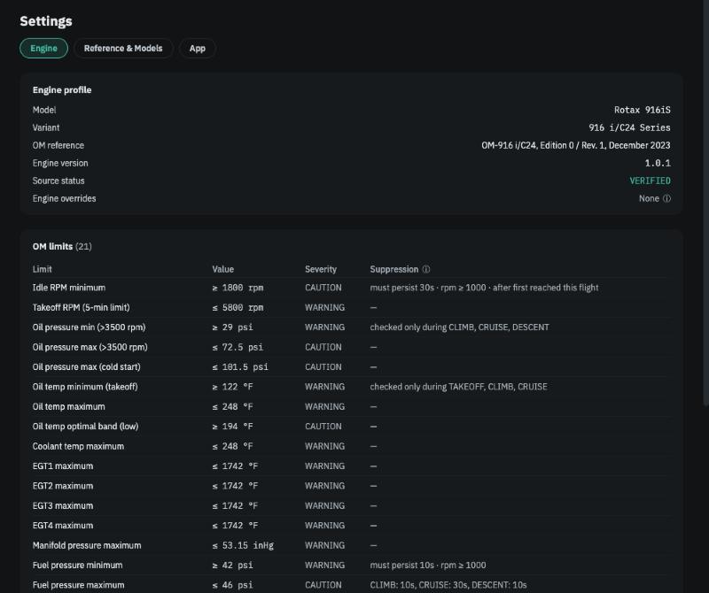
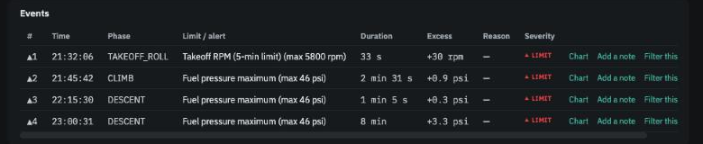

# Operators Manual limits and events

**In brief.** The Rotax Operators Manual sets limits — temperatures, pressures, RPM, boost, time at takeoff power. When a reading crosses one for long enough to matter, the app records an **event**: when, in which phase, for how long and by how much. The engine computer's own **ENGINE ECU** alert is treated the same way, once the app has sorted the expected occurrences (start, lane check, shutdown) from the unexpected. Events are listed in the **Events** table on the Flight view and summarised on the *Operators Manual limits* card; a flight with any carries a **LIMIT** badge.

## Where the limits come from

Each workspace is tied to one engine model, and its limits come from that model's Operators Manual — the edition and revision are shown under *Settings → Engine* alongside the full table. The table is read-only: the limits are Rotax's, not the app's and not yours. What *you* control is what to do about an event that keeps happening (see [Your decisions](your-decisions.md)).

Twenty-one limits are checked on a 916iS, including per-cylinder EGT maximums, the EGT split between cylinders, manifold pressure, fuel pressure both ways, bus voltage both ways, and the five-minute rule for takeoff power. The 915iS and 912iS tables differ in a few values and in what exists at all — the 912iS has no turbo and no EGT-split limit. [Operators Manual limits by engine](../reference/om-limits.md) lists them side by side.

<figure class="screenshot" markdown>
{ .screenshot }
<figcaption>Settings → Engine: every limit, its value, its severity label and when it is checked.</figcaption>
</figure>

## How an event is found

A reading past a limit for a single second is not an event. Three rules keep the Events table honest:

**Some limits need the excursion to last.** Idle minimum must persist 30 s before it counts — a brief dip as the governor settles is normal. Fuel pressure minimum needs 10 s. Fuel pressure maximum needs 10 s in climb and descent but 30 s in cruise, where switching tanks causes a longer, harmless spike.

**Some limits are only checked when they make sense.** Low oil pressure, low fuel pressure and low voltage are not checked with the engine stopped. Oil pressure minimum is checked only once airborne. The oil-temperature-before-takeoff minimum is checked from the takeoff roll on. Fuel pressure maximum is not checked during taxi at all, because that is when you run the pump test. The *Suppression* column in the limits table shows these rules per limit.

**Nearby excursions are one event.** Once a reading has gone past a limit, the event does not end until the reading has been back inside for 30 s. A value that bounces across the line for two minutes is one two-minute event, not forty tiny ones.

What remains is listed in the **Events** table: time, phase, which limit, duration, how far past, and a link that jumps the chart to that moment. Each limit appears at most once per flight.

<figure class="screenshot" markdown>
{ .screenshot }
<figcaption>The Events table: one row per limit exceeded, with phase, duration and excess.</figcaption>
</figure>

## Severity labels

Each limit carries a label from the manual's own wording — **WARNING** or **CAUTION** — and each event inherits it. The labels are there to help you read the table. The app does not treat the two differently: it does not hide a caution, escalate a warning, or decide on your behalf that one deserves action and the other does not.

## Time at takeoff power

The manual allows takeoff power — above 5,500 rpm, or 100 % power — for no more than five minutes at a stretch. The app measures the longest continuous block you spent there (with the same 30 s rule joining brief dips). Going past 300 s is an event like any other. Coming within a minute of it is noted on the *Time at takeoff power* card as a **close call**, which usually means power was not reduced promptly after takeoff — a long climb-out, a delay — and is worth a glance at your habits rather than your engine.

The 5,800 rpm ceiling is separate: it is a hard limit with no time allowance. A brief overshoot as the governor catches a prop is the most common cause, and the kind of thing a filter with a small tolerance is for.

## Engine computer alerts

The engine computer raises an **ENGINE ECU** caution on the panel for many reasons, most of them routine. The app records every occurrence and sorts it by what the aircraft was doing:

| When it happened | What the app makes of it |
|---|---|
| While the avionics and engine computer were coming up, before or during start | Expected. Counted on the *Engine computer alerts in flight* card, nothing more. |
| During the lane check — stationary, RPM in the lane-check band, two short runs | Expected; this is the single-lane test. The flight header reports *both lanes ✓*, *one lane only* or *not detected*. |
| At shutdown, as the engine is cut | Expected. Counted only. |
| On the ground with the engine running, but not a lane check | **An event.** Listed in the Events table with the reason it is not a lane check — for instance that the RPM was below the lane-check band. |
| In flight, from the takeoff roll to the landing roll | **An event**, and the one that matters. Not expected; worth having the engine computer's fault log read at the next maintenance. |

Occurrences shorter than a few seconds are counted as *blips* and not treated as events, because a single logged reading can be an artefact. The lane-check band depends on the engine — around 4,000 rpm on the 916iS and 912iS, around 2,500 rpm on the 915iS.

## Where events go next

Events are facts about one flight, but their *pattern* over many flights is what tells you about the engine. Every limit that has ever been exceeded in a workspace gets its own panel on the [Trends](trends.md) page, showing on which flights it fired and by how much. And a limit that fires on every flight for a reason you understand — a sensor that reads a little high, an installation quirk — can be given a [filter](your-decisions.md) with a note, after which the app shows those events collapsed into one line and keeps watching for the day the pattern changes.

---

*Further reading: Spec 01 (engine contract) §§ on limit detection and CAS classification, and Spec 09 (limit filters), in the [repository](../reference/further-reading.md).*
