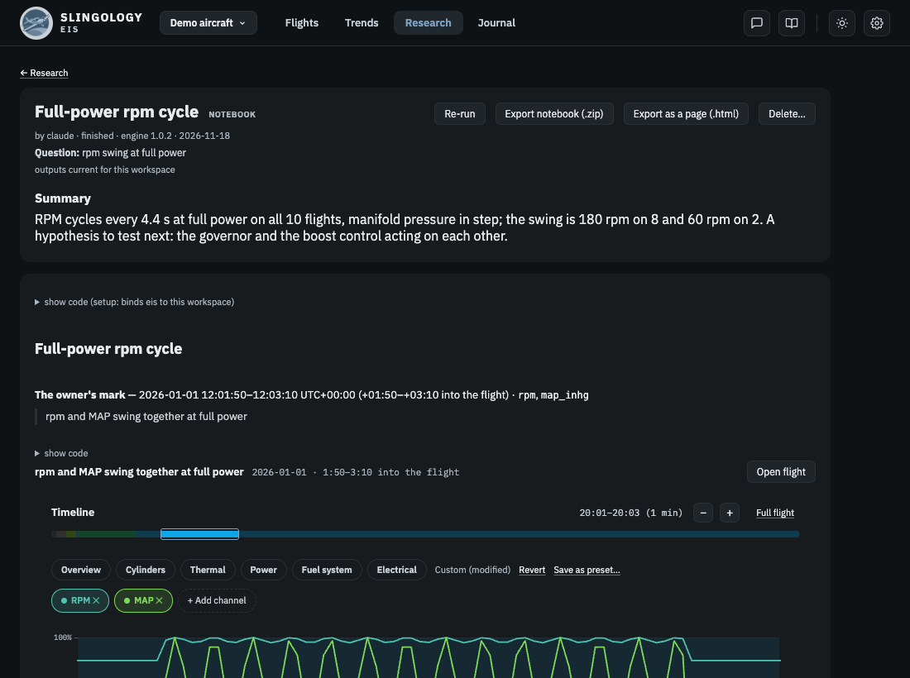
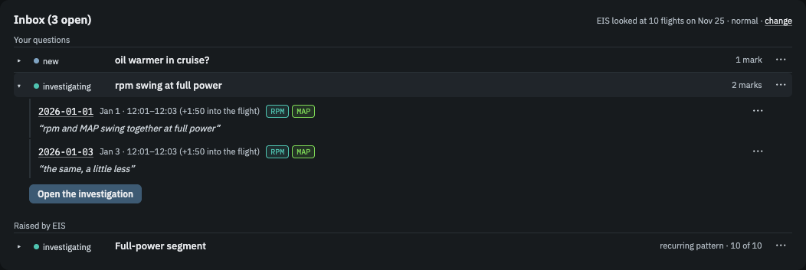

# Investigations: asking Claude about your engine

**In brief.** You look at your flights in EIS and mark what looks odd; with the EIS extension installed in Claude Desktop, you ask Claude — *Investigate*, with no text, takes your newest marked question — and Claude investigates: it starts from your marks, measures across your flights with the EIS instrument, writes code against your logs where no measurement fits, reads the manuals you've given it, and writes what it found into EIS as a **notebook** you can read, re-run and share. Your logs stay on your computer. Claude investigates; EIS measures.

## What an investigation is

The oscillation case — 180 rpm of cycling on nearly every takeoff, inside every limit, unchanged for 145 hours — was found by a loop: cut every full-power segment, notice manifold pressure moving in step with rpm, read the engine manual's boost schedule, form a hypothesis about the governor and the boost control arguing, test it against altitude, rule out two other explanations, and write it up so the propeller manufacturer recognised it from one email. The measurements took minutes; the loop took judgement. Claude did the loop, with the owner steering.

An investigation is that loop, done by your Claude with EIS as its instrument. You bring what you saw and the question; Claude does the measuring, reading and writing; you steer and decide.

<figure class="diagram">
--8<-- "diagrams/research-investigation-loop.svg"
<figcaption>Look and mark in EIS, ask in Claude Desktop, read the notebook in EIS.</figcaption>
</figure>

## What you need

- **The Claude Desktop app** on a Mac, with your own Claude account. EIS runs no AI itself and holds no key: the conversation is yours, on your account.
- **The EIS extension** for Claude Desktop — one file, one install ([Install the extension](../walkthroughs/install-extension.md)). It carries the EIS engine, runs the EIS pages on your computer at `http://127.0.0.1:8420/` while Claude Desktop is open, and gives Claude its connection to them.
- **Your logs** in a folder EIS can read, as on the website. If you started on the website, its **Move my workspace to EIS on this computer** button brings your questions, marks and decisions across ([Install the extension](../walkthroughs/install-extension.md), step 4); after the move you work at `http://127.0.0.1:8420/`, and the website's workspace is the copy.
- **Context worth giving it**, in **Settings → Aircraft** ([Set up your aircraft and documents](../walkthroughs/aircraft-documents.md)): the aircraft's configuration and **notes** on what was changed and when, which Claude reads before every investigation; and **documents folders** with your copies of the Operators Manual, service bulletins and the propeller and controller manuals, which Claude reads in place and cites by page. EIS never ships the manuals and never copies them.

## How it goes

1. **Look and mark.** On a flight, turn on **Signal** under the chart, zoom to what looks odd, and **Mark for Claude** — a sentence of what you see, under a question. Mark the same thing on other flights under the same question ([Mark something for Claude](../walkthroughs/mark-for-claude.md)). You can skip this and just ask.
2. **Ask.** In Claude Desktop, open a chat and choose **Investigate** from the chat's **+** menu. With no text it takes your newest open question; with text that names one of your questions it takes that one; anything else is a new question in your words — *"the climb after my touch-and-go at KBLI on Oct 24 felt like a surge; look into it."*
3. **Claude works.** A notebook opens with your marks — your note, then a log view of each window — and Claude starts from what you saw. You see its steps in the chat and the notebook forming on the Research page. It measures what the question is about: whether something swings and repeats, whether two channels move together, whether a measurement differs before and after a change, which flights stand out — or, for anything else, it loads the data and plots it ([What EIS measures](../reference/what-eis-measures.md)).
4. **Steer.** *"Compare with every other takeoff." "Does it depend on altitude?" "What does the controller manual say about its governing band?"*
5. **Read.** The notebook in EIS: the question and summary at the top, then the narrative, each measurement with its output, figures, tables and **log views** — the Flight view's chart for the window that matters, with *Open flight*. The code is folded under *show code*. When Claude finishes, your question is marked *watching* (or what Claude and you decided), with the notebook linked from it.

{ .screenshot }

A notebook is an ordinary Jupyter notebook. It opens unchanged in JupyterLab, where you can run it yourself against your workspace ([Run a notebook in JupyterLab](../walkthroughs/notebook-jupyterlab.md)), and *Re-run* on the Research page runs it again on your current flights, holding any output that changed for you to accept or discard. On the website, notebooks open and read the same way; running them needs EIS on your computer.

## The inbox

The inbox on the Research page holds two kinds of thing, with the same statuses.

**Your questions**, with their marks across flights. Each mark opens its flight at the window, with the channels you were looking at. Rename a question, move a mark to another question (or to *Unassigned*), edit its note, delete it. A question Claude has taken up has *Open the investigation*.

**What EIS raised.** When the Research page opens after new flights, EIS runs its own cheap scan — no AI — over the preset slices of the recent flights and keeps only patterns that hold across many of them: a repeating cycle in governed rpm, a measurement that has moved against your reference, a group of slices that stands apart. Each comes with what fired and the evidence table (every slice, each opening its flight at that moment). The **Look at this inbox item** prompt in Claude Desktop takes one.

{ .screenshot }

Mark either kind *Nothing here*, *Watch* or *Acted*, with a note. *Nothing here* is a legitimate result. How much the scan raises is **Settings → Research → Inbox sensitivity**: *quiet* (a pattern in 8 of the last 10 slices), *normal* (6 of 10, the default) or *curious* (4 of 10). On the website the inbox works the same, and an open question carries a line on handing it to Claude with the extension.

The scan never puts anything on a flight's cards, and a single odd flight is not a scan item — that is what your own marks are for. EIS never says what a pattern means; that is the investigation's.

## What stays true

- **No verdicts.** A notebook says what the data did, how big, how often, compared with what; it never says *fault* or *abnormal* without the reference beside it. The judgement is yours, with the Operators Manual and the people who built the parts.
- **Traceable.** Every claim in a notebook comes from a measurement, a code cell's output, or a cited document — or it is labelled a hypothesis. The code is there to read.
- **Your marks are yours.** A mark holds a flight, a window, the channels shown and your sentence. EIS adds nothing to it; Claude reads it as what you saw, not as a finding.
- **Private.** Logs never leave your computer. What travels is what Claude asked the instrument for, inside your own conversation.
- **Fenced on a Mac — and only there.** On a Mac, macOS itself fences in the code Claude runs on your computer: it can't reach the internet, start other programs, or change any file outside its own study folder. That fence exists only on a Mac, and the macOS tool it uses is one Apple has deprecated, though it still works today; on Windows and Linux only EIS's own, weaker check applies. On every computer the code can *read* any file you can, and what it reads can end up in your conversation with Claude.

## What to do with this

Next time something feels odd in flight, find it on the flight with Signal on, mark it, and choose *Investigate*. [Reproducing a takeoff investigation](../walkthroughs/research-takeoff.md) walks the original case that way.

## How it works

The extension bundles the EIS engine, a Python of its own, the EIS pages and an **MCP server** — the standard way Claude Desktop talks to local tools — in one process that Claude Desktop starts and stops. The pages see the same workspace, so a notebook cell written by Claude appears in your browser as it is written, and a mark you make appears to Claude at once. Claude calls tools: read your questions and marks, find flights, read channels, cut slices, run a test, run Python against the workspace, read a document from your folders, append a notebook cell ([the tools](../reference/investigation-tools.md), [the prompts](../reference/investigation-prompts.md), [the `eis` library](../reference/eis-library.md), [the notebook format](../reference/notebook-format.md)). Claude never opens a log file; the engine answers tool calls. The design is [Spec 16 — Investigations](https://github.com/AlchemyGeek/Rotax9iSEIS/blob/main/docs/specs/16-investigations.md); the instrument it drives is [Spec 06 — Research](https://github.com/AlchemyGeek/Rotax9iSEIS/blob/main/docs/specs/06-research.md).
