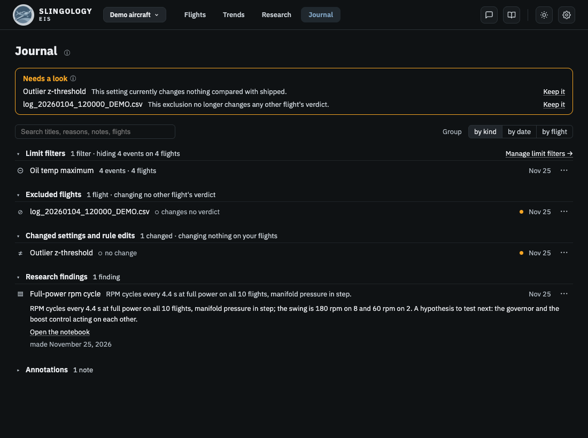
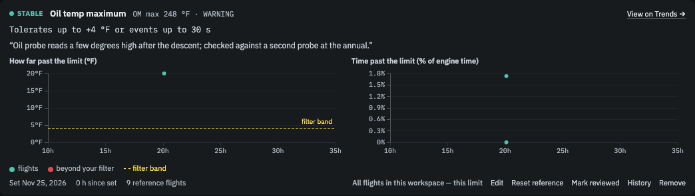

# The Journal

**In brief.** The **Journal** lists every decision currently in force in the workspace — each filter, rule edit, excluded flight, pinned reference, changed setting, research finding and annotation — with what it is doing *right now*. It is a register, not a log: reverse a decision and its entry disappears; edit one and its entry updates. Anything that needs your attention — a filter that has been breached or is drifting, a decision that no longer does anything — floats to the top, and the count on the **Journal** item in the top bar tells you how many.

## Why a register and not a history

A pilot managing an aircraft wants to know *what is in effect*. Which limits have I tolerated, and within what bounds? Which rules have I changed from the defaults? Which flights are out of the reference, and why? A history of every change ever made answers a different question, and buries the first one. So the Journal keeps one entry per live decision and nothing else. There is no settings changelog; if a setting differs from the app's default, the Journal lists it with both values.

<figure class="screenshot" markdown>
{ .screenshot }
<figcaption>One line per decision, grouped by kind, each with what it is doing now. A research finding is expanded.</figcaption>
</figure>

## How the page reads

Anything that needs you comes first, in a **Needs a look** block — and only when there is something in it. Below it, every decision is **one line**: a small mark for its kind, its title, what it is doing now in a few words (*4 events · 4 flights*, *changes no verdict*, *+1 insight · 1 flight*), and the date it was last changed. A decision that currently does nothing says so in grey with a hollow dot.

The lines are grouped by kind, each group under a header with its count and its total effect — *1 filter · hiding 4 events on 4 flights*. Filters, exclusions, changed settings and research findings are open; annotations and acknowledgements start folded; a kind with nothing in it is not shown at all. Above the list, a **search** box finds a word in any title, reason, note or flight, and **Group** switches between *by kind*, *by date* and *by flight*.

Click a line and it opens in place: the value (your band, the new setting beside the shipped one), what it applies to, your reason and note in quotes, and when it was made and changed. The **⋯** menu at the end of the line holds the actions: *Edit*, the decision's reversal — *Remove filter*, *Include again*, *Enable*, *Unpin*, *Reset to shipped*, *Remove from Journal* — which first says what it would change, and *Open the notebook* for a research finding.

**Manage limit filters →** in the filters header opens each filter's full card — its status, how far past the limit and how long each flight went, and the reference it watches against — with *Edit*, *Reset reference*, *Mark reviewed* and *Copy filters from…* another workspace with the same engine.

<figure class="screenshot" markdown>
{ .screenshot }
<figcaption>A filter's card: status, its band, your note, and every flight's excess against the band.</figcaption>
</figure>

## What is listed

| Kind | The line shows | Opened, it adds |
|---|---|---|
| **Limit filter** | The limit, and the events and flights it hides now. | Your band and duration, the phases it leaves out, your note; *Remove filter*. |
| **Excluded flight** | The flight, and whether excluding it changes a verdict. | Your reason; *Include again*. |
| **Changed setting** | The setting, and the insights it changes. | The value beside the shipped default; *Reset to shipped*. |
| **Rule edit** | The topic, and the insights the edit adds or removes. | The trigger's value beside the shipped one; *Reset to shipped*. |
| **Disabled topic** | The topic, and the insights it would have raised. | *Enable*. |
| **Pinned reference** | The metric, and how many flights it is pinned to. | The pinned flights and your label; *Unpin*. |
| **Research finding** | The notebook's title and its finding in one sentence. | The notebook's summary; *Open the notebook*, *Remove from Journal*. |
| **Annotation** | The first line of your note. | The whole note and what it is attached to; *Delete*. |
| **Acknowledged insight** | Reserved for single-insight acknowledgements, which are planned. | |

The counts are recomputed every time you open the page.

**Research findings.** When Claude finishes a notebook and you ask it to keep the finding, the Journal records the notebook's title and one sentence of what was found ([From a finding to action](research-action.md)). The line follows the notebook: if the notebook is reopened and finished again, the line is rewritten from it.

## Change notices

Some entries need you. They move to the top and are counted on the nav badge:

- A filter that is **breached** or **drifting** (see [Your decisions](your-decisions.md)). The Flights page carries a one-line banner pointing here.
- A decision with **zero effect** — a filter with nothing left to suppress, an exclusion that changes no verdict. Usually the cue to remove it.
- A **pinned reference older than the recent window** — a reminder that the comparison is now against a fixed past.

## What is not here

Changing the display units, the data location or updating the app creates no entry; none of those affects any result. And the Journal never contains anything the app decided on its own, because the app does not make decisions — it only records yours.
