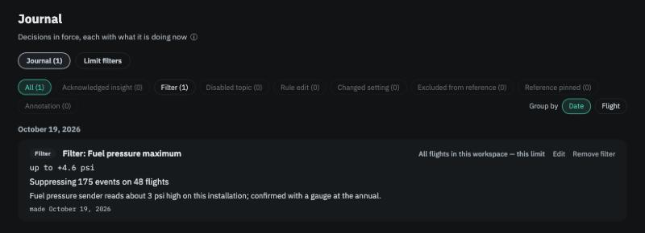

# The Journal

**In brief.** The **Journal** lists every decision currently in force in the workspace — each filter, rule edit, excluded flight, pinned reference, changed setting and annotation — with what it is doing *right now*. It is a register, not a log: reverse a decision and its entry disappears; edit one and its entry updates. Anything that needs your attention — a filter that has been breached or is drifting, a decision that no longer does anything — floats to the top, and the count on the **Journal** item in the top bar tells you how many.

## Why a register and not a history

A pilot managing an aircraft wants to know *what is in effect*. Which limits have I tolerated, and within what bounds? Which rules have I changed from the defaults? Which flights are out of the reference, and why? A history of every change ever made answers a different question, and buries the first one. So the Journal keeps one entry per live decision and nothing else. There is no settings changelog; if a setting differs from the app's default, the Journal lists it with both values.

<figure class="screenshot" markdown>
{ .screenshot }
<figcaption>Decisions in force, each with what it is doing now.</figcaption>
</figure>

## What is listed

| Kind | Entry shows |
|---|---|
| **Filter** | The limit, its OM value, your band, duration and excluded phases, your note; the filter's status (*Stable*, *Drifting*, *Breached*, *Review due*, *Quiet*, *Collecting*); two small charts of how far past the limit and how long, with the filter's reference shaded and breaches ringed; actions to edit, re-baseline, mark reviewed or remove; *Copy filters from…* another workspace with the same engine. |
| **Rule edit** | The topic and trigger, the current value beside the shipped default. |
| **Disabled topic** | The topic, with *Enable*. |
| **Excluded from reference** | The flight and your reason, with *Include again*. |
| **Reference pinned** | The metric, the pinned flights and your label, with *Unpin*. |
| **Changed setting** | Any *Reference & Models* value that differs from the default, one entry per setting. |
| **Annotation** | A note you attached to a flight or event — the only thing the Journal creates itself. |
| **Acknowledged insight** | Reserved for single-insight acknowledgements, which are planned. |

Every entry carries a link to the flight, limit, topic or metric it concerns, when it was made and last changed, and a **live count of its effect**, recomputed when you open the page: *suppressing 9 events on 6 flights*, *currently suppresses nothing*. Entries can be filtered by kind and grouped by date or by flight.

## Change notices

Some entries need you. They move to the top and are counted on the nav badge:

- A filter that is **breached** or **drifting** (see [Your decisions](your-decisions.md)). The Flights page carries a one-line banner pointing here.
- A decision with **zero effect** — a filter with nothing left to suppress, an exclusion that changes no verdict. Usually the cue to remove it.
- A **pinned reference older than the recent window** — a reminder that the comparison is now against a fixed past.

## What is not here

Changing the display units, the data location or updating the app creates no entry; none of those affects any result. And the Journal never contains anything the app decided on its own, because the app does not make decisions — it only records yours.
