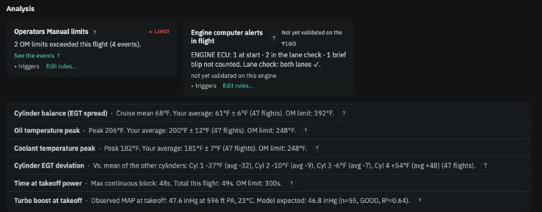
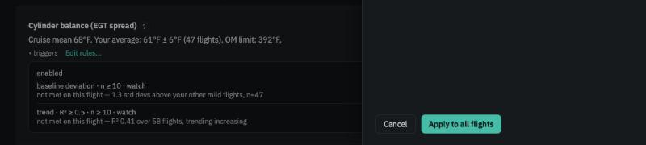

# Topics and insights

**In brief.** A **topic** is one thing the app watches — oil temperature peak, cylinder balance, boost at takeoff. Each topic has a **card** on the Flight view. The card always carries an **analysis line** (this flight's number, your usual, the manual's limit), and *sometimes* an **insight** — a short statement that something about this flight is worth your attention. Cards with nothing to add stay collapsed to their one line. The flight's insights are gathered in the left column of the Flight view, and the Flights page shows each flight's count.

## The two-layer card

Every topic card is written in the same two layers so that you always know what you are looking at.

The **analysis line** is always present and purely descriptive. It states the measurement, your reference, and the limit, in one sentence:

> *Peak 183°F. Your average: 201°F ± 12°F (47 flights). OM limit: 248°F.*

Nothing in it is a judgement. If this is all the card says, the flight was ordinary on that topic.

The **insight** appears only when one of the topic's **triggers** has fired — the flight sits outside your usual range, a trend has become clear, a limit was crossed. It says what was found in plain language and, where the app can say so without guessing, what it *can point to*: a widening cylinder spread can point to an injector or a plug; a boost lower than expected to the turbo, wastegate or an intake leak. The card expands, shows the insight with a severity label, and offers the actions that apply.

<figure class="diagram">
--8<-- "diagrams/two-layer-card.svg"
<figcaption>Every card has the first line. Only some have the second.</figcaption>
</figure>

<figure class="screenshot" markdown>
{ .screenshot }
<figcaption>Topic cards: collapsed to their analysis line unless there is something to say.</figcaption>
</figure>

## What fires an insight

Each topic has one or more triggers, shown under the card's *triggers* disclosure with their current values and whether they were met:

| Trigger | Fires when |
|---|---|
| **Baseline deviation** | This flight sits outside your usual range for the metric (more than the outlier threshold, default 2 standard deviations), with at least *n_min* (default 10) comparable flights behind the comparison. |
| **Trend** | The metric has been moving steadily with engine hours — a straight line fits well enough (R² ≥ 0.5) over at least 10 flights, in the direction the topic cares about (cylinder spread only matters if it is *widening*; a cylinder's deviation matters either way). |
| **Threshold** | A fixed test: a limit was exceeded, or a takeoff's boost sat further from your own model than your takeoffs normally vary. |

<figure class="screenshot" markdown>
{ .screenshot }
<figcaption>The triggers disclosure: each trigger, its values, and how close it came on this flight.</figcaption>
</figure>

The card's *triggers* line shows how close a trigger came: *trend · R² ≥ 0.5 · n ≥ 10 — not met: R² 0.30 over 23 flights*. You can change the numbers for any topic from its card — see [Your decisions](your-decisions.md) — and the edit applies to every flight in the workspace.

## Severity labels

Insights carry a label: **LIMIT** (an Operators Manual limit was crossed), **WARNING**, **WATCH** or **INFO**. As with events, the labels are a reading aid. The app does not hide an *info*, escalate a *warning*, or treat any of them as a verdict. What differs is only the colour on the Flights page, which shows each flight's worst label and count.

## One event, one card

Where a topic concerns something that is also an Operators Manual limit — oil temperature peak and the oil maximum, coolant peak and the coolant maximum, time at takeoff power and the five-minute rule — the limit event is reported once, on the *Operators Manual limits* card and in the Events table, and the topic card simply mirrors the badge. You will not see the same exceedance raised twice in different words. Likewise, when one cylinder on its own explains a widening spread, the insight appears under *Cylinder EGT deviation* and the spread card points there.

## Still building, not yet validated

Two notes appear on cards and mean different things:

- **Still building your reference — N more flights** means the comparison is not being made yet because there is not enough history. The number is shown; the judgement is withheld.
- **Not yet validated on this engine** means the topic was developed and checked on a 916iS and no data from a 915iS or 912iS has yet confirmed that it behaves sensibly there. The card works; treat its insights with that in mind. [The topics](the-topics.md) lists each topic's status by engine.

## What is not a topic

Fuel burned, cruise miles per gallon and cruise fuel flow appear in the Flight view header as **flight facts** — logbook figures for your planning. They mostly reflect wind, weight and the power you chose, miles per gallon uses ground speed, and fuel flow is the engine computer's estimate rather than a measurement. So they are shown but never compared and never raise an insight.

---

*Walkthrough: [Reading your first flight](../walkthroughs/first-flight.md).*
