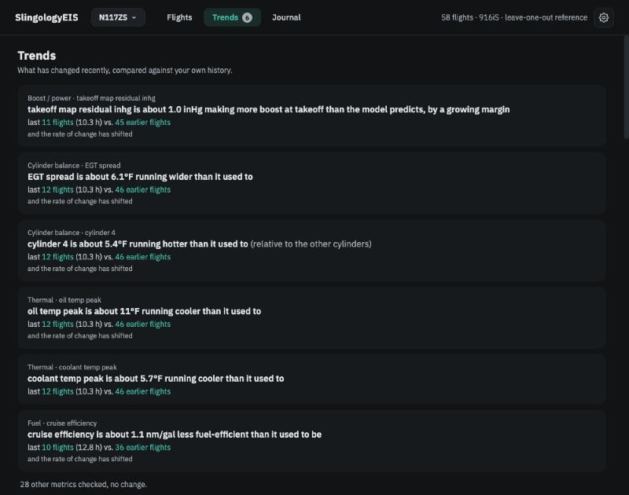
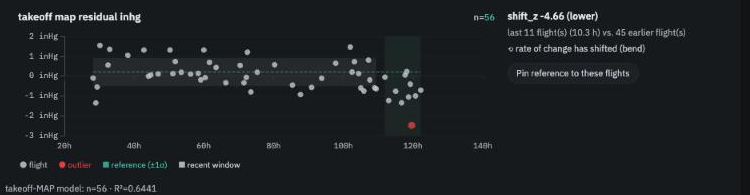

# Trends: is my engine changing?

**In brief.** The Flight view asks whether *one flight* was unusual. **Trends** asks whether *your engine* has been changing: it compares your most recent flights — the last 10 engine hours or so — with everything before, metric by metric, and lists at the top the ones that have moved. Below the summary, one panel per area shows each metric over engine hours with your usual range shaded, the recent window marked, and the Operators Manual limit drawn where there is one. A number on the **Trends** item in the top bar tells you how many changes are open.

## Two different questions

A single unusual flight can be weather, a long taxi, a short hop. A metric that has *shifted* — whose recent average sits somewhere different from where it used to — is a change in the engine or its installation, and it can be small enough that no single flight was ever flagged. Trends is built to find the second kind.

<figure class="diagram">
--8<-- "diagrams/shift.svg"
<figcaption>Shift: the recent window's average sits away from the reference's average.</figcaption>
</figure>

## The change summary

The top of the page is a plain-language list, one row per metric that has moved, ranked by how far it moved:

> **Cylinder balance · cylinder 4** — cylinder 4 is about 5.4 °F running hotter than it used to (relative to the other cylinders) — last 12 flights (10.3 h) vs. 46 earlier flights — *and the rate of change has shifted*

Each row names the area and metric, states the change in the metric's own units and direction, says which flights were compared, and adds qualifiers where they apply: the rate of change has shifted (a *bend* — the metric was drifting slowly and now drifts faster, or has started to); the recent average is *within 25 % of the OM limit*; it has reached *the edge of your filter band*; or, for a pinned reference, *since <your label>*. There are no severity colours here; the ranking is the message.

Under the list: *N other metrics checked, no change.* A collapsed *Past changes* section lists shifts that have since cleared.

<figure class="screenshot" markdown>
{ .screenshot }
<figcaption>The change summary: what has moved, by how much, compared with what.</figcaption>
</figure>

## What "shift" means

For each metric the app takes the **recent window** — the newest flights spanning at least the last 10 engine hours, with at least 5 flights and at most 15 — and compares their average with the average of all your earlier contributing flights, using the same *unusual* threshold as everywhere else (2 standard errors by default). Where a metric depends on weather, recent flights are compared with earlier flights in the same temperature or density-altitude band when there are enough of them; otherwise the row says *mixed comparison*. A shift is also declared if the recent average has crossed the line at 75 % of the headroom to an Operators Manual limit, or the edge of a filter band, even if the move is statistically small.

The window is a setting, not a slider on the page: *Settings → Reference & Models → Window*.

## Rolling or pinned reference

By default the reference a metric is compared against is **rolling** — every earlier contributing flight, growing as you fly. That is right for watching a gradual drift.

Sometimes you want a fixed point: the twenty flights before you changed an injector, or before the annual. *Pin reference to these flights* on any panel fixes that metric's reference to the flights currently in the window and labels it; from then on every flight is compared with that set until you *Unpin*. The strip shows the pinned region hard-edged and marks later flights as *not used* for the reference. A pin is a decision, listed in the Journal, and the Journal will tell you when a pin is older than the recent window. Filters keep their own frozen reference regardless of pins.

## The panels

Below the summary, metrics are grouped into panels. Each strip plots the metric against **engine hours**, one point per flight, with your usual range (mean ± 1σ) shaded, the recent window highlighted, outliers ringed, and the OM limit drawn as a labelled line where one exists, with a fainter line at 75 % of the headroom. Click a point to open that flight. *Stratify by OAT/DA* redraws the band per weather condition. *Show detail strips* adds the whole-history fit and time-above-limit.

- **Cylinder balance** — the four deviation lines, the hottest-cylinder strip, and the spread. See [Cylinder balance](cylinder-balance.md).
- **Thermal** — oil and coolant peaks, with climb thermal rate as context.
- **Boost / power** — time at takeoff power against the 300 s limit; boost at takeoff as the difference from your own model (the model's fit is in the caption).
- **Fuel · planning** — cruise efficiency and cruise fuel flow. Marked *planning* because they reflect wind, weight and power setting; listed last.
- **Limit: …** — one panel per Operators Manual limit that is filtered or has ever been exceeded in this workspace. The first strip is an **event strip**: a tick per flight that had an event, headed *exceeded on 2 of 12 recent flights · 1 of 46 earlier* — how often is the primary signal. Below it, the size of the excess on the flights that had one, with the limit as the zero line and any filter band drawn.
- **Alert: ENGINE ECU** — the same event strip for engine-computer alerts that were not expected.
- **Never exceeded (N)** — a collapsed group of limits with nothing to show.

<figure class="screenshot" markdown>
{ .screenshot }
<figcaption>One strip: reference band, recent window, outliers ringed, the OM limit drawn.</figcaption>
</figure>

## Readiness notes

A strip that cannot yet say anything says why: *building reference · N more flights*, *too few flights*, *conditions not comparable yet*, *never exceeded*, *filtered*, *baseline pinned*. These are the same situations as on the Flight view cards; the Trends page simply shows them per metric.

## Settings that shape this

| Setting | Default | Where |
|---|---|---|
| Recent window (hours) | 10 h | Settings → Reference & Models → Window |
| Min / max flights in window | 5 / 15 | same |
| OM margin fraction | 0.25 (the 75 % line) | same |
| Outlier z-threshold | 2.0 | Settings → Reference & Models → Comparison |
| Pinned references | none | per panel on Trends; listed under Reference & Models |

## What Trends does not do yet

Projecting when a drifting metric would reach its limit, marking maintenance events on the time axis, and a strip of operating conditions under each chart are planned for a later version.

---

*Further reading: Spec 12 (Trends as a change page) in the [repository](../reference/further-reading.md).*
