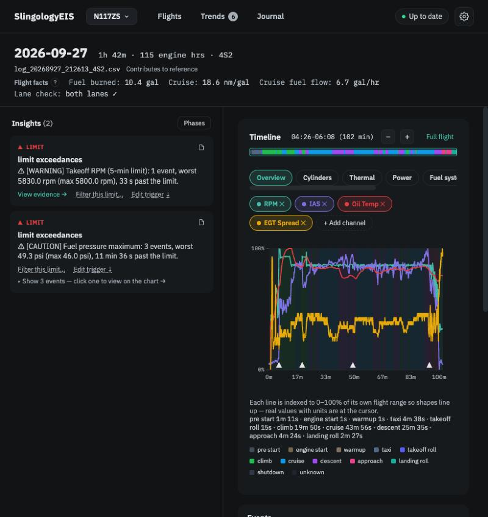

# What EIS tells you

**In brief.** Every flight is checked in two independent ways. First against the **Rotax Operators Manual** — fixed limits that apply to every engine of your model. Second against **your own history** — what this particular engine usually does in similar conditions. The first produces *events*; the second produces *insights*. Both appear on the Flight view, and the long-term version of the second is the Trends page.

## Two questions, two kinds of answer

Engine monitoring tools usually blur two different questions together. SlingologyEIS keeps them apart because they call for different responses.

**Did anything go past a limit?** The Operators Manual gives numbers — maximum oil temperature, minimum fuel pressure, how long you may stay at takeoff power. These are the same for every 916iS, or every 915iS, or every 912iS. When a reading crosses one of them for long enough to matter, the app records an **event**: when it happened, in which phase of flight, for how long, and by how much. Events are facts about the flight. They are listed in the *Events* table on the Flight view, and a flight that had any carries a *LIMIT* badge on the Flights page.

**Was this flight unusual for my engine?** No manual can tell you what *your* oil temperature peak normally is on a mild day, or how far apart your four cylinders' exhaust temperatures usually sit. The app learns that from your previous flights and calls it your **reference**. Each flight is then compared with the reference, metric by metric. When something sits clearly outside its usual range — or has been drifting steadily as engine hours build — the app raises an **insight**. Insights are judgements, not facts, and they are only as good as the history behind them, which is why the first ten or so flights say *still building*.

<figure class="diagram">
--8<-- "diagrams/two-questions.svg"
<figcaption>Limits are the same for every engine of your model. The reference is yours alone.</figcaption>
</figure>

## Where you meet it

On the **Flight view**, the left column lists the flight's insights and the header shows its *flight facts* — fuel burned, cruise miles per gallon — which are just numbers for your planning and never raise an alert. Below the timeline chart sits the **Events** table (limits and alerts), and below that the **Analysis** section with one card per topic. A card with nothing to say is collapsed to a single line: *Peak 183°F. Your average: 201°F ± 12°F (47 flights). OM limit: 248°F.* That line always shows the three things side by side — this flight, your usual, and the manual's limit.

<figure class="screenshot" markdown>
{ .screenshot }
<figcaption>The Flight view: this flight's insights, flight facts, the timeline with its phases, and the events table.</figcaption>
</figure>

The **Trends** page asks the second question over a longer horizon: not "is this flight unusual" but "has my engine been changing". See [Trends](trends.md).

## How it works

The two checks run on every flight the moment it is analysed, and again whenever something that affects them changes — a new engine version, a rule you edited, a flight you excluded from the reference.

The limit check reads every value the engine reported against the limit table for your engine model (you can see the whole table under *Settings → Engine*). It knows about the moments when a reading is *expected* to be out of range — the fuel pump test before takeoff, a cold start, idle on the ground — and allows for them, so you are not told about things that are part of normal operation. Brief single-reading blips are ignored. What remains becomes events. [Operators Manual limits and events](limits-and-events.md) explains the details.

The reference check takes each metric the app tracks — about thirty of them — and asks how this flight's value compares with the same metric on your earlier flights, preferably flights flown in similar outside air temperature or density altitude. "Clearly outside the usual range" means more than about two standard deviations from your average; that threshold is the *outlier z-threshold* in *Settings → Reference & Models* (default 2.0). [Your reference](your-reference.md) explains how the reference is built and why it is never shared between aircraft.

## What the app does not do

It does not grade the flight, score the engine or combine the two questions into a single verdict. It does not decide for you that an event you have seen a hundred times is fine — but it gives you a way to say so yourself, with a note, and then keeps watching for the day that event changes. See [Your decisions](your-decisions.md).

---

*Further reading: the research paper [Rotax 91XiS Engine Data Analytics](../reference/research-paper.md) sets out the reasoning behind this two-question design.*
