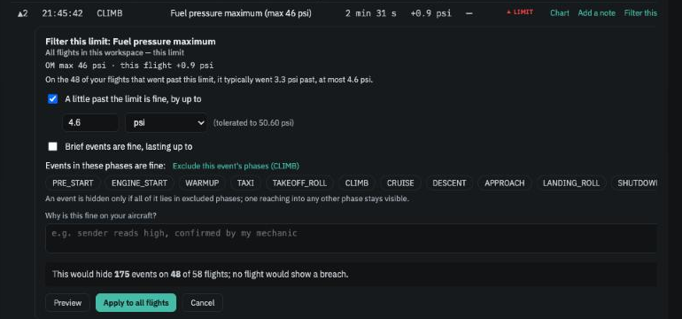
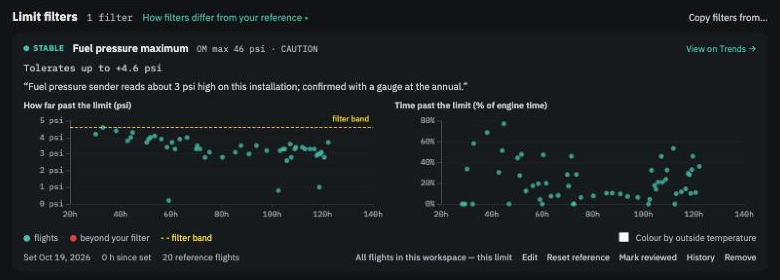
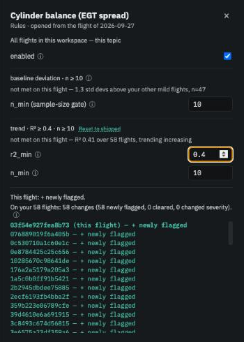

# Your decisions

**In brief.** The app reports; you decide. When an event or an insight is something you understand and accept, you can tell the app so — with a **filter** on a limit, an **edit to a topic's rules**, a flight **excluded from the reference**, or a **disabled topic**. Each decision says plainly whether it applies to *this flight only* or to *all flights in this workspace*, and shows you its effect before you confirm. Every decision in force is listed in the [Journal](the-journal.md), and the app keeps watching the thing you tolerated and tells you when it changes.

## The idea

Every engine has quirks. A fuel-pressure sender that reads a couple of psi high. A prop governor that lets the RPM touch 5,820 for a few seconds on every takeoff. A cylinder that has always run 50 °F hotter. Report them once and they are information; report them on every flight and they are noise that buries the thing you actually need to see.

The app will not decide for you that a quirk is harmless. What it offers instead is a way for you to say so, in a form that is recorded, reversible, and still watched. That last part matters: a filtered limit is not switched off. The app keeps measuring it and tells you if the pattern changes — if the sender starts reading five psi high instead of two, or the overshoot starts lasting longer.

## Scope: this flight, or every flight?

The question to ask of any decision is *what does it apply to*. The app answers it on every control before you confirm, with a caption such as *All flights in this workspace — this limit* or *This flight only*. The distinction:

- A **filter** or a **rule edit** is a statement about your engine. It applies to every flight, past and future, in the workspace. Editing a trigger from one flight's card does not make the edit about that flight.
- **Excluding a flight from the reference** is a statement about one flight. It applies to that flight only — though because the reference is built from all the others, other flights' comparisons will move a little.

<figure class="diagram">
--8<-- "diagrams/decision-scope.svg"
<figcaption>Most decisions are about the engine, and so about every flight.</figcaption>
</figure>

## Filter a limit

A filter says: *on my aircraft this limit is exceeded in a way I understand and accept, within these bounds.* One filter per limit per workspace, created from any event row (*Filter this limit…*) or from the limit's insight card. It has up to three independent conditions, and an event is tolerated if **any one** of them covers it:

- **Magnitude** — "a little past the limit is fine": up to a fixed amount in the limit's own units (say +2.5 psi), a percentage of the limit, or, once there is enough history, a number of standard deviations from the filter's own reference.
- **Duration** — "brief excursions are fine": events up to N seconds are tolerated.
- **Excluded phases** — "not during taxi": an event lying wholly within the phases you tick is tolerated. The app can pre-select the phase of the event you started from, but only if you ask.

Before you save, a preview says exactly what the filter would do across the workspace: *This would hide 412 events on 38 flights; 2 flights would still show a breach.* A note is required for a **WARNING** limit and optional for a **CAUTION**; one limit — oil pressure minimum — can never be filtered, and the 5,800 rpm ceiling allows only a small absolute tolerance.

Afterwards, tolerated events collapse on every Flight view into one line per limit — *17 fuel pressure events within your filter, up to +2.5 psi* — expandable if you want the detail. An event the filter does not cover is a **breach**: shown as an ordinary row, marked *beyond your filter*.

<figure class="screenshot" markdown>
{ .screenshot }
<figcaption>Creating a filter: the conditions, the note, and what it would do across the workspace.</figcaption>
</figure>

<figure class="screenshot" markdown>
{ .screenshot }
<figcaption>The filter's card in the Journal: its status, every flight's excess against the band, and the reference it watches against.</figcaption>
</figure>

**What the app keeps watching.** When you create a filter it freezes a reference — your twenty most recent flights that had this event — and from then on compares every new flight with it. The filter's card in the Journal reports a status: *Stable*; *Breached* (an event the filter did not cover); *Drifting* (the last couple of flights went further past the limit, or events are becoming more frequent, than the reference); *Review due* (a set number of engine hours has passed); *Quiet* (no events on the last ten flights — perhaps the filter is no longer needed). Breached and drifting filters are counted on the Journal badge and announced in a banner on the Flights page. *Mark reviewed* clears a breach or a review; drift clears itself when the pattern settles, or you *Re-baseline* the filter if the new pattern is the one you now accept.

## Edit a topic's rules

Every topic card shows its triggers and their current values under *▸ triggers*. *Edit rules…* (or *Edit trigger ↓* on an insight) opens an editor beside the card where you can change the numbers — how many flights a comparison needs, how strong a trend must be before it is reported, a trigger's severity label — or switch the topic off. Triggers that follow an Operators Manual limit are shown as such and cannot be given a different number.

As you edit, a live preview counts the effect across the workspace: *On your 58 flights: 4 changes (1 newly flagged, 3 cleared)*, with the affected flights linked. *Apply to all flights* saves it; *Reset to shipped* puts a rule back to the app's default. While any rule differs from shipped, the Journal shows the current and shipped values side by side.

<figure class="screenshot" markdown>
{ .screenshot }
<figcaption>Editing a trigger: the values, and what would change across every flight.</figcaption>
</figure>

## Disable a topic

The *enabled* switch in the same editor. The card stays on every Flight view, collapsed to one line — *Cylinder balance · disabled · Enable* — so you can always see that a topic is off and turn it back on in context. Disabling *Operators Manual limits* hides that card's insights only; events are still detected, still feed filters, and still appear on Trends.

## Exclude a flight from the reference

From the flight's header, the *In reference* mark on the Flights page, or an insight's *Exclude this flight from reference →*. You give a reason — a post-maintenance test flight, a known bad probe, a ferry flight flown unlike your norm — and the flight stops shaping what other flights are compared against. It keeps its own analysis and its own insights. The change takes effect on the next *Rebuild reference* (*Settings → Reference & Models*), and the preview tells you whether any flight's verdict would change. *Include again* reverses it through the same dialog.

## Pin a metric's reference

On the Trends page, *Pin reference to these flights* fixes a metric's baseline to a chosen set of flights instead of the rolling history. It is a decision like the others — recorded in the Journal, reversible with *Unpin* — and is described on the [Trends](trends.md) page.

## Acknowledge a single insight

Sometimes an insight is right, you have looked, and there is nothing more to do — a hot day, a known short flight. Acknowledging it is a *this flight only* decision that marks that one insight as seen without changing any rule. The Journal has a place for these.

!!! note
    Acknowledging from the insight card is planned and not yet in the app. Until it arrives, the way to note "seen, no action" on one flight is an annotation on the event or flight.

## Undoing

Every decision is listed in the Journal with its current effect and an edit or remove action. Removing a filter, resetting a rule, re-including a flight or unpinning a reference deletes the Journal entry; nothing is kept as history. If a decision is currently doing nothing — a filter with no events to suppress, an exclusion that changes no verdict — the Journal says so, which is usually the cue to remove it.

---

*Walkthrough: [From an insight to a decision](../walkthroughs/insight-to-decision.md). Further reading: Spec 09 (limit filters) and Spec 14 (settings, Journal and rule editing) in the [repository](../reference/further-reading.md).*
