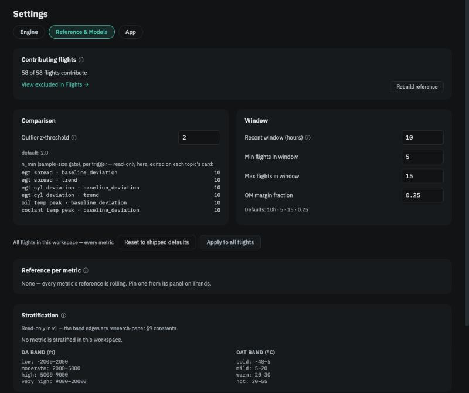

# Your reference

**In brief.** Your **reference** is what the app has learned, from your own flights, about what each reading usually is on *this* engine — the average and the normal scatter, ideally on days with similar weather. Every flight is compared with it, and a reading well outside its usual range becomes an insight. It takes about ten flights to form; until then cards say *still building*. It is learned from one aircraft and never applied to another. You see it in every card's *Your average: … ± … (N flights)* line, as the shaded band on Trends charts, and under *Settings → Reference & Models*.

## Why "usual" has to be yours

Two 916iS engines in two Sling TSis will not run the same oil temperature on the same day. Cowling, baffling, oil cooler, probe placement, the individual engine — all of it shifts the numbers by more than the differences the app is trying to detect. A fleet-wide "normal" would hide exactly the changes that matter. So the app builds its idea of normal from your flights alone, and when it says *higher than usual* it means higher than *your* usual. The only numbers shared between aircraft are the Operators Manual limits.

## How the reference is built

For each metric the app tracks — cylinder spread, each cylinder's deviation, oil and coolant peaks, boost at takeoff, and so on — the reference is the **average and standard deviation across your other flights**. "Other" is literal: when judging a flight, that flight is left out of its own reference, so one unusual flight cannot make itself look normal.

<figure class="diagram">
--8<-- "diagrams/reference-band.svg"
<figcaption>Your usual range for one metric (shaded) and a flight that sits outside it.</figcaption>
</figure>

**Similar conditions.** A hot day raises every temperature on the engine; a high-elevation airport changes what the turbo can deliver. So where weather matters, the reference is built from flights in the same conditions:

- Thermal metrics (cylinder spread and deviations, oil peak, coolant peak) are compared within the same **outside-air-temperature band**: cold (below 5 °C), mild (5–20 °C), warm (20–30 °C), hot (above 30 °C).
- Cruise fuel figures and boost at takeoff are compared within the same **density-altitude band**: low (below 2,000 ft), moderate, high, very high (above 9,000 ft).

If your band has too few flights yet — fewer than ten — the comparison falls back to all your flights, and the card says which it used: *higher than your other warm-day flights (14)* or *higher than all your flights (23)*.

**Building.** No comparison is made until there are at least **10** other flights to compare with (the *n_min* for each trigger, visible under *Settings → Reference & Models*). Below that the card still shows the flight's own number, with a note that the reference is still building and how many more flights it needs. The turbo-boost model needs five takeoffs, and it never judges a takeoff whose elevation or temperature is outside anything you have flown before.

## What "unusual" means

A flight is flagged when a metric sits more than about **two standard deviations** from your average — the *outlier z-threshold*, default 2.0. In everyday terms that is roughly the outer 5 % of your own history. On a typical engine it works out to something like 10 °F in cylinder spread, 20–25 °F in oil peak, 15 °F in coolant peak before anything is said. It also means that, by chance alone, about one flight in twenty will be flagged on any given metric. One unusual flight is worth a look; the same metric unusual on several flights is a pattern.

The same threshold rings outlier points on the Trends charts and ranks the Trends change summary, so "unusual" means the same thing everywhere in the app.

<figure class="screenshot" markdown>
{ .screenshot }
<figcaption>Settings → Reference & Models: which flights contribute, the outlier threshold, the recent window, and the condition bands.</figcaption>
</figure>

## Trends over engine hours

Besides *is this flight unusual*, the reference answers *is this metric drifting*. The app fits a straight line to the metric against **engine hours** across all your flights and reports a trend — increasing, decreasing or flat — only when the line explains at least half the variation (R² ≥ 0.5) and there are at least ten flights. Below that gate no trend line is drawn and no trend insight fires; a weak trend is not reported as if it were a strong one.

## Which flights contribute

Every flight the app admits contributes, unless you exclude it. You might exclude a flight after a maintenance event that changed the engine, a flight with a known bad probe, or a ferry flight flown very differently from your norm. Exclusion needs a reason, applies to that one flight, and takes effect when the reference is next rebuilt. The flight keeps its own analysis and insights; it simply stops shaping what other flights are compared against. See [Your decisions](your-decisions.md).

The reference is **rolling** by default: every earlier contributing flight is in it, and it grows as you fly. On the Trends page you can **pin** a metric's reference to a particular set of flights — say, the twenty flights before a cylinder was changed — so that later flights are always compared with that fixed baseline. See [Trends](trends.md).

## Settings that shape this

All under *Settings → Reference & Models*, all applying to every flight in the workspace:

| Setting | Default | What it does |
|---|---|---|
| Outlier z-threshold | 2.0 | How far from your average a reading must sit to be *unusual*. |
| *n_min* per trigger | 10 | How many other flights the reference needs before a comparison is made. Shown here; edited on each topic's card. |
| Recent window | 10 h, 5–15 flights | Which flights count as "recent" on the Trends page. |
| Rebuild reference | — | Recompute after excluding or re-including flights. |

The condition bands are fixed; they come from the research behind the app and are shown for information.

---

*Further reading: research paper §9 (stratification) and Spec 12 (Trends) in the [repository](../reference/further-reading.md).*
