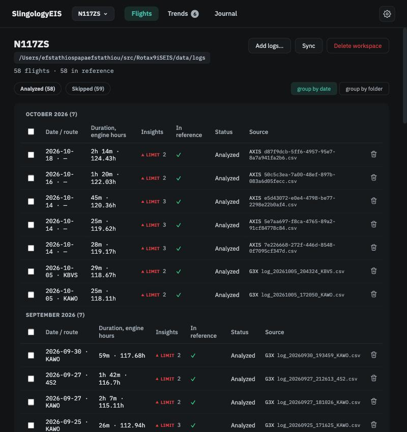

---
hide:
  - toc
---

# SlingologyEIS

**Engine health analytics for Rotax iS aircraft engines — built for how a FADEC engine actually works.**

SlingologyEIS reads the engine logs your Garmin avionics already record on every flight and answers two questions about each one:

1. **Did anything go outside the Rotax Operators Manual limits?**
2. **Was this flight unusual for *your* engine?**

The limits come from Rotax. The idea of "usual" comes from your own flight history. What to do about either is your call — the app never silences anything on its own, and it never stops watching something you've told it to tolerate.

**[Open SlingologyEIS](https://alchemygeek.github.io/Rotax9iSEIS/app/)** — it runs entirely in your browser. There is nothing to install and no account; the analysis happens on your computer and the results stay there. Your logs stay in your own folders — the app reads them; it never copies or uploads them. If you would rather run it as a program on your own machine, you can ([how](walkthroughs/first-workspace.md#running-the-app-on-your-own-computer)).

!!! warning "Keep a copy of your workspace"
    Your workspaces are kept by your browser, on this device. Clearing the site's data removes them, and a browser short of space may clear them on its own. **Settings → App → Export workspace…** writes one file that restores everything — make one after your first analysis and whenever you have made decisions you would not want to redo. [How](walkthroughs/export-import.md).

!!! tip "No logs yet? Try the sample workspace"
    [Download the sample workspace](https://github.com/AlchemyGeek/Rotax9iSEIS/releases/download/sample-workspace/SlingologyEIS-sample-N117ZS.zip) (10 MB) — a season of N117ZS, the Sling TSi the app was developed on: 19 flights, the three filters its owner set and why, and one annotation. Open the app, go to **Settings → App → Import workspace…** and pick the zip; the app analyses the flights in about a minute. Then look at Trends for the widening EGT spread, open the 2 September flight to see the fuel-pressure filter at work, and read the Journal. The sample is the same workspace the screenshots on this site were taken from.

<figure class="screenshot" markdown>
{ .screenshot }
<figcaption>Every flight in a workspace, with its insights at a glance.</figcaption>
</figure>

## Two ways to read this site

**If you want to get going**, start with the walkthroughs. They are picture-led and take you from opening the app to making your first decision about an insight:

- [Open the app and your first workspace](walkthroughs/first-workspace.md)
- [Reading your first flight](walkthroughs/first-flight.md)
- [From an insight to a decision](walkthroughs/insight-to-decision.md)
- [Export and import](walkthroughs/export-import.md)

**If you want to understand what the app is telling you**, read the concept pages in order. Each one opens with a short *In brief* that tells you what the idea is and where you meet it in the app; the rest of the page explains how it works and which settings shape it. Stop whenever you have what you need.

- *Understanding your engine's data* — [what EIS tells you](concepts/what-eis-tells-you.md), [why a FADEC engine is different](concepts/why-fadec-is-different.md), [logs, flights and workspaces](concepts/logs-flights-workspaces.md), [phases of flight](concepts/phases-of-flight.md)
- *What EIS watches* — [limits and events](concepts/limits-and-events.md), [your reference](concepts/your-reference.md), [topics and insights](concepts/topics-and-insights.md), [the topics](concepts/the-topics.md), [cylinder balance](concepts/cylinder-balance.md)
- *Deciding what matters* — [your decisions](concepts/your-decisions.md), [Trends](concepts/trends.md), [the Journal](concepts/the-journal.md)
- *Working with others* — [sharing a workspace](concepts/sharing-a-workspace.md)

## Found a problem? Have an idea?

Tell us on the **[SlingologyEIS feedback board](https://feedback.slingology.synology.me/)** — no GitHub account needed. Report something that looks wrong, suggest a feature, or vote for the ideas other pilots have posted; the votes help decide what gets built next. When reporting a problem, say which page you were on, what you expected, what you saw and which browser you use; a screenshot helps. If the problem is in the analysis of a flight, a [workspace export](walkthroughs/export-import.md) lets it be seen exactly as you see it — say in the report that you can share one.

## What this app is, and isn't

SlingologyEIS is a reading aid for the data your engine already produces. It will show you when a reading went past a limit, when a flight looks different from your own history, and when something about your engine has been slowly changing. It will not tell you whether your aircraft is airworthy, and it does not replace the Operators Manual, your maintenance schedule or your mechanic. When the app says something is *worth raising with your mechanic*, that is what it means — a conversation starter with the evidence attached, not a diagnosis.

## Which engines

Rotax **912iS**, **915iS** and **916iS**. The Operators Manual limits for all three are built in and verified against the manuals. The analytics themselves were developed and validated on a 916iS; on the other engines each topic is marked *unverified* until there is data from such an aircraft. See [The topics](concepts/the-topics.md) for the status of each.

## Which logs

Garmin **G3X** logs copied from the SD card, **Garmin Pilot** exports, and Garmin **AXIS** exports. The app recognises the format from the file itself, and a workspace can mix them.

---

*Free and open source under the MIT licence. The project, its source code and the research paper behind the analytics are at [github.com/AlchemyGeek/Rotax9iSEIS](https://github.com/AlchemyGeek/Rotax9iSEIS).*
