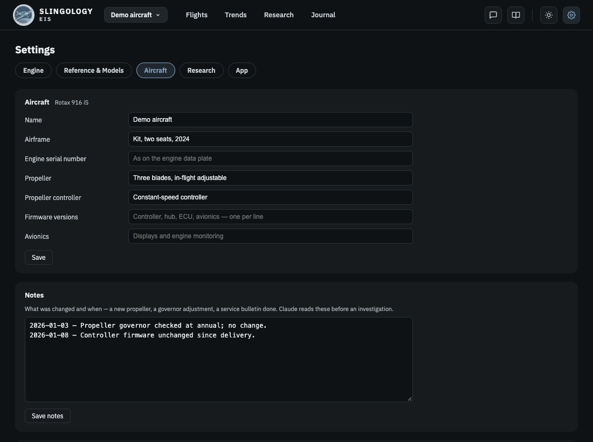
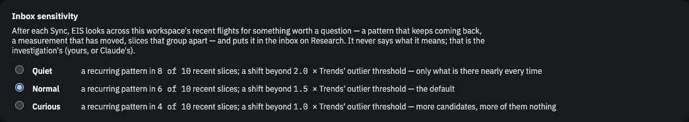

# Set up your aircraft and documents

*Ten minutes, once. What Claude should know about your aircraft before it investigates: how it is configured, what has been changed and when, and where your manuals are. All of it lives in **Settings → Aircraft** in the EIS pages, and Claude reads it at the start of every investigation.*

## 1. The aircraft record

Open **Settings → Aircraft**. The aircraft was created with your first workspace and carries its engine model.

{ .screenshot }

Fill in what you know: the airframe, the engine serial number, the propeller, the propeller controller, the firmware versions (one per line), the avionics. **Save**.

These are free text — write them as you would to a mechanic. Claude uses them to know which manual applies and which part a pattern might involve.

## 2. Notes: what changed, and when

Under **Notes**, keep a dated line for each change that might show in the engine data:

```
2026-03-02 — Propeller re-pitched at annual (+0.5°)
2026-06-18 — Controller firmware 2.14 → 2.16
2026-09-05 — Fuel pump replaced under SB-xx
```

**Save notes**. A pattern that starts on the day of a change is a different finding from one that has always been there; with these notes Claude can tell them apart and the **Before / after** prompt has something to compare.

## 3. Documents folders

On your computer, keep your copies of the Operators Manual, the service bulletins and the propeller and controller manuals in a folder (PDF, Markdown or text; subfolders are fine). Under **Documents folders**, type the folder's full path — e.g. `/Users/you/Aircraft/Manuals` — **Add**, then **Save folders**.

EIS reads them in place: nothing is copied into EIS, and nothing leaves your computer. Claude lists them, searches them for a phrase and reads the pages it needs, citing the page in the notebook. A changed file is re-read the next time it is used.

On the website this section is greyed and marked **EXTENSION ONLY**: a browser can't read a folder by its path. It works with the [extension](install-extension.md), or EIS installed with `pip`.

## 4. More than one workspace

**This aircraft's workspaces** lists every workspace of the aircraft. If a workspace is really another aircraft's — a test cell, a friend's logs, a different engine — the list says so when its engine differs from the record's:

> This workspace's profile is Rotax 915 iS; the aircraft record says Rotax 916 iS. If it is another aircraft, move it to its own.

**Move to another aircraft…**, then pick the aircraft or **A new aircraft…** with a name, and **Move**. Claude opens the aircraft named in the extension's settings (or the only one), so keeping each aircraft's workspaces together keeps its investigations on the right flights.

## 5. Inbox sensitivity

**Settings → Research** sets how much the inbox raises for this workspace — *quiet*, *normal* or *curious* — with what each means in recent slices.

{ .screenshot }

Start with *normal*. If the inbox raises things you keep marking *Nothing here*, try *quiet*; if you'd rather see more and dismiss more, *curious*.
