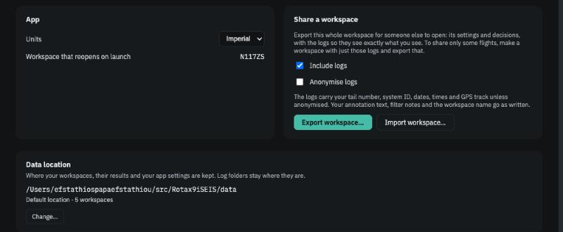

# Export and import

*Five minutes. How to hand your whole workspace — flights, decisions and all — to another pilot, your mechanic, or anyone helping you read your engine; and how to open one someone sent you. The same export is your **backup**: the workspace lives in your browser's storage, and an export is the only copy that survives the site's data being cleared. Make one after each batch of decisions.*

## Exporting

### 1. Decide what to share

Open **Settings → App → Share a workspace**. Two choices:

- **Include logs** — on by default. The logs are what the recipient's app analyses; without them they get a description of a workspace but nothing to look at. Leave this on unless the recipient already has the logs.
- **Anonymise logs** — off by default. Replaces your tail number and avionics ID with a pseudonym, blanks the GPS track and radio columns, and renames the files. Dates, times and engine hours stay, because the analysis needs them. The notice under the checkboxes says exactly this, every time.

The export is always the **whole active workspace**. To share only some flights, make a workspace that points at a folder containing just those logs, and export that.

<figure class="screenshot" markdown>
{ .screenshot }
<figcaption>Settings → App: include logs, anonymise, export, import.</figcaption>
</figure>

### 2. Check your own words

If you chose to anonymise, the export dialog lists the places where your tail number still appears in text you typed — notes, filter reasons, the workspace name. The app does not rewrite your words; edit them first if it matters.

### 3. Export

**Export workspace…** writes one file: a `.zip` when logs are included, a small `.eisworkspace` file when not. Send it however you like. It contains your settings, every decision in force (filters, rule edits, exclusions, pins), your Journal and annotations, and the list of your flights — not the analysis results, which the recipient's app recomputes, and nothing about your computer or folder paths.

## Importing

### 1. Open the file

**Settings → App → Import workspace…**, or *Import workspace…* from the workspace switcher in the top bar. Import always creates a **new** workspace; it never changes one you have.

### 2. Read the summary

Before anything is created, the app shows what is in the file: whose it is, which engine and app version, how many flights, how many filters and rule edits. The new workspace's name defaults to the sender's with *(imported)* added. If the file came from a newer version of the app than yours, the import is refused with a message; from an older one it proceeds with a notice.

### 3. Let it match the logs

The logs are unpacked into a folder of their own and matched against the sender's flight list:

> *38 of 40 flights found · 2 missing · 12 other logs held out*

Then the usual analysis runs. You see the workspace as the sender saw it — their filters, exclusions and pins in force, their Journal entries, their annotations.

### 4. Understand the leftovers

- A flight the sender had but whose log did not arrive is listed under **Skipped** as *In the sender's workspace — log not found*. The sender's decisions about it wait until the log appears.
- A log that was in the zip but not in the sender's workspace — perhaps they had skipped it — is **held out**, listed with *Include* if you want it.

## A note on what you are sharing

An engine log carries your tail number, your avionics' serial number, the date and time of every flight and your GPS track. Anonymising removes the identity and the track. The dates remain. If that is more than you want to share, share fewer flights. See [Sharing a workspace](../concepts/sharing-a-workspace.md).
