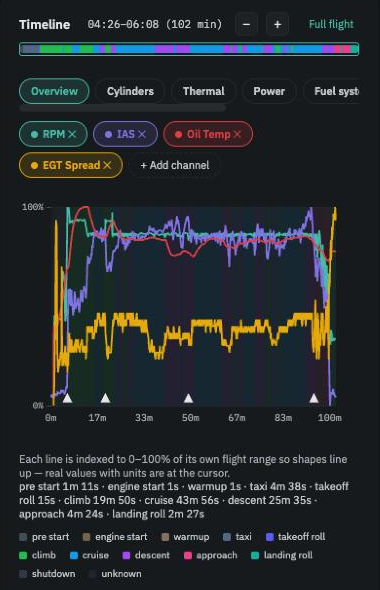

# Reading your first flight

*Five minutes. Open any flight from the Flights page — a longer one with a proper cruise is the most informative.*

## The header: facts, not judgements

The top line is the date, duration, engine hours and the airport the log was named after. Beneath it, **Flight facts**: fuel burned, cruise miles per gallon, cruise fuel flow, and whether the lane check covered both lanes. These are logbook numbers for your planning. They are never compared with anything and never raise an alert, because wind, weight and the power you chose dominate them.

*Contributes to reference* means this flight is part of what the app considers normal for your engine.

<figure class="screenshot" markdown>
{ .screenshot }
<figcaption>Header with flight facts, this flight's insights, and the timeline with its phases.</figcaption>
</figure>

## The left column: what needs your attention

**Insights** lists anything the app found worth saying about this flight. A *LIMIT* badge means an Operators Manual limit was crossed; the line under it says which, how far and for how long. A *WATCH* badge means a reading was unusual for your engine, or a trend has become clear. If the column is empty, nothing was flagged — the flight was ordinary.

Each insight offers the next step: *View evidence* jumps the chart to the moment; *Filter this limit…* and *Edit trigger* are decisions, covered in [the next walkthrough](insight-to-decision.md).

## The timeline: the flight as the engine saw it

The chart plots a handful of channels — the **Overview** preset shows RPM, airspeed, oil temperature and EGT spread — each scaled to its own range so that shapes line up. Real values with units appear at the cursor. The coloured bands behind the traces are the **phases of flight**, and the caption below lists how long each lasted. Switch presets (*Cylinders*, *Thermal*, *Power*, *Fuel system*, *Electrical*) or add a channel to see something else; zoom with **−** and **+**.

<figure class="screenshot" markdown>
{ .screenshot }
<figcaption>Phases as coloured bands; durations in the caption.</figcaption>
</figure>

## The Events table: limits and alerts

Below the chart, every Operators Manual limit crossed on this flight, and every unexpected engine-computer alert, as one row each: the time, the phase, which limit, how long, by how much. *Chart* jumps to the moment. A row is a fact about the flight; what to do about it is yours to decide.

<figure class="screenshot" markdown>
{ .screenshot }
<figcaption>Two limits exceeded on this flight, listed with duration and excess.</figcaption>
</figure>

## The Analysis section: one card per topic

Each topic the app watches has a card. Most are **collapsed to one line** — this flight's number, your usual, the manual's limit:

> *Oil temperature peak · Peak 206°F. Your average: 200°F ± 12°F (47 flights). OM limit: 248°F.*

Read across the line and you have the whole picture for that topic. A card expands only when it has something to add. The **?** on each card explains what the topic measures and what a change can point to.

<figure class="screenshot" markdown>
{ .screenshot }
<figcaption>Cards with nothing to add stay on one line.</figcaption>
</figure>

## Two notes you will see early on

*Still building your reference — N more flights* means there is not yet enough history to compare against; the number is shown, the judgement is withheld.

*Not yet validated on this engine* appears on a 915iS or 912iS: the topic works, but no data from such an engine has yet confirmed it behaves sensibly there.

## Reading habit

One unusual flight is a note to yourself. The same thing unusual on several flights is a pattern, and the place to see patterns is **Trends**, which is what the concept pages [Your reference](../concepts/your-reference.md) and [Trends](../concepts/trends.md) are about.

**Next:** [From an insight to a decision](insight-to-decision.md).
