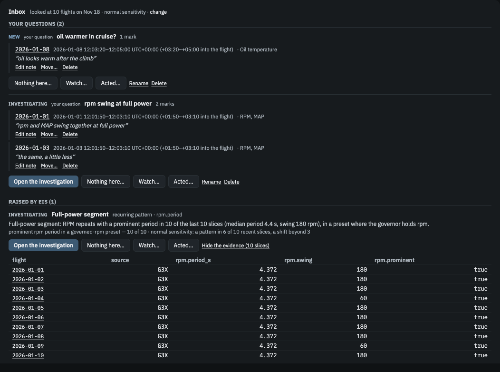
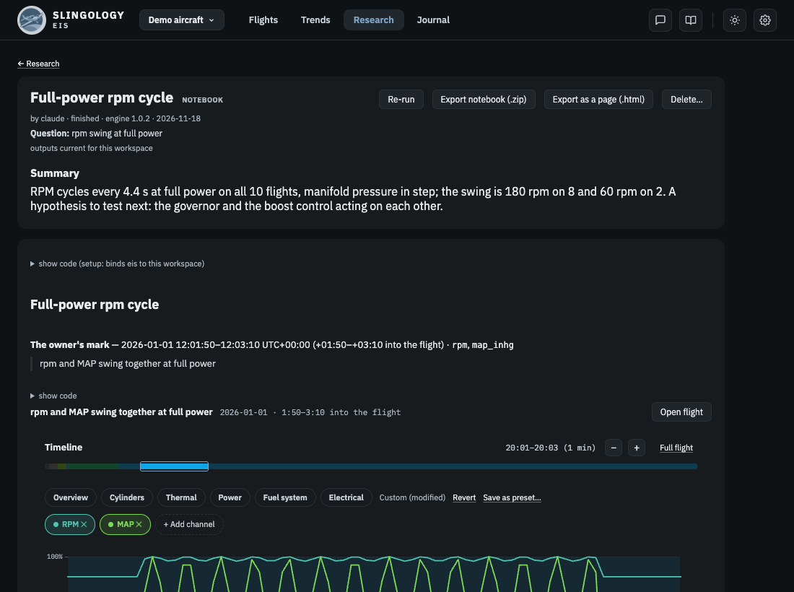

# Your first investigation

*Twenty minutes. Ask Claude a question about your engine, watch it work through EIS, and read the notebook it writes. You need the [extension installed](install-extension.md) and a workspace with your flights; [your aircraft and documents](aircraft-documents.md) set up make the answer better.*

## 1. Pick a question

Something you noticed, in your own words. Good first questions name a flight and a feeling:

- *The climb after the touch-and-go at Bellingham on Oct 24 felt like a surge. Look into it.*
- *Is there an oscillation during takeoff and initial climb?*
- *Has the oil temperature in cruise changed since the new propeller?*

Or start from the inbox: a candidate on the Research page is a question EIS noticed for you.

{ .screenshot }

## 2. Ask

In Claude Desktop, open a new chat. Either type the question, or pick **Investigate** from the chat's **+** menu and give it the question — the prompt puts the EIS method in front of Claude: one flight first, then all of them; the manuals; a hypothesis with the alternatives ruled out; what it means and what to do.

For an inbox candidate, pick **Look at this inbox item** and give it the candidate's id (Claude can list them: *what's in my EIS inbox?*).

## 3. Watch it work — and steer

Claude says what it is doing as it goes: which flight it found and why, the window it is looking at, the slices it cut across your flights, the numbers that came back, the manual page it read. Steer as you would with a colleague:

> Compare that with every other takeoff.
> Does it depend on density altitude?
> What does the controller manual say about its governing band?

Open **Research** in the EIS pages (http://127.0.0.1:8420/): the notebook is listed as *notebook · Claude* and fills in as Claude appends cells.

## 4. Read the notebook

Open it from Research.

{ .screenshot }

- **The header**: the question, who wrote it, *finished* or still open, the engine version, and whether its outputs are current for this workspace. Then the **summary**: what was found, what it means, what to do.
- **The cells**, in order. Markdown says what comes next or what a result means. A **log view** is the Flight view's chart for the window that matters — channels, zoom and read-outs as on the Flight view — with **Open flight** to see it in the whole flight. A **code cell** shows its output; the code is folded under *show code*, for anyone who wants to check it.
- Every number comes from a tool result, a code cell's output or a cited page; a mechanism is called a hypothesis. If something reads as a verdict without its reference, ask Claude where it came from.

## 5. Keep it, use it

- **Re-run** runs every code cell again on your current flights. Outputs that changed wait beside the old ones: **Accept all new outputs** or **Discard all**.
- **Export notebook (.zip)** gives the notebook with its files, for another owner of the same engine — they import it from **Research → Import a study or notebook…**, and its cells re-run on their flights where they have EIS on their computer. Your logs don't travel.
- **Export as a page (.html)** gives a page anyone can open — for a mechanic or a manufacturer's support desk, with two sentences of your own.
- To keep the finding in the **Journal**, ask Claude when it finishes — *put the finding in my Journal* — and add what you decided there.

If the investigation came from the inbox, the candidate now shows **Open the investigation**; mark it *Watch*, *Acted* (say what was done) or *Nothing here*.

The original case, from a look at one flight to the notebook, is [Reproducing a takeoff investigation](research-takeoff.md).
