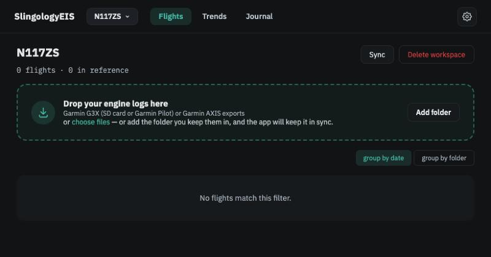
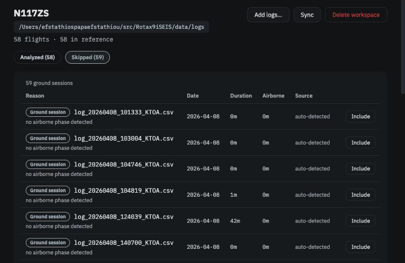

# Install and your first workspace

*About fifteen minutes, most of it the app working. You need a Mac, Windows or Linux computer with Python 3.10 or later, Node.js 20 or later (used once, to build the app), and a folder of engine logs from your Garmin G3X, Garmin Pilot or AXIS.*

## 1. Install and start

Open a terminal and run:

```bash
git clone https://github.com/AlchemyGeek/Rotax9iSEIS.git
cd Rotax9iSEIS
pip install -e .
cd web && npm ci && npm run build && cd ..
slingology-eis serve
```

The last line prints an address — `http://127.0.0.1:8420/` — open it in your browser (tested on macOS Chrome and Safari, and iPad Safari). Leave the terminal window open while you use the app; `Ctrl-C` there stops it.

!!! note
    Nothing listens on your network. The app runs on your computer and is reachable only from it. A packaged build that removes the Node step is on the project's list.

## 2. Create a workspace

The app asks for a workspace **name** and the **engine model**, with an optional tail number. Name it after the aircraft. Choose the engine carefully — it decides which Operators Manual limits apply and cannot be changed later (you would make a new workspace).

<figure class="screenshot" markdown>
{ .screenshot }
<figcaption>Your new workspace, before any logs.</figcaption>
</figure>

## 3. Point it at your logs

Click **Add folder** and type the path to the folder where you keep your logs — subfolders are included. Or drop files onto the page. The app only *reads* this folder; it never copies, moves or renames anything in it. You can add more folders later, and if you move logs around, **Sync** finds them again.

The app lists everything it found with *Needs analysis* beside each log, and an **Analyze N** button appears.

## 4. Analyze

Click **Analyze**. The app reads each log, decides whether it is a flight, works out the phases of flight, checks the Operators Manual limits and builds your reference. A season of logs takes a minute or two; the page shows progress per log.

When it finishes, a notice sums up what happened — *58 new flights analyzed · 59 skipped — not a flight* — and the list fills in.

<figure class="screenshot" markdown>
{ .screenshot }
<figcaption>Every flight with its date, duration, engine hours, insights and source file.</figcaption>
</figure>

## 5. Look at what was skipped

Click **Skipped**. Logs that did not become flights are listed with the reason: a ground run, a flight under ten minutes, a log with a gap in it. This is normal — every engine start writes a log, and most of a year's logs are not flights. If one looks wrong, open it to check and click **Include**.

<figure class="screenshot" markdown>
{ .screenshot }
<figcaption>Skipped logs, each with its reason, each includable.</figcaption>
</figure>

## 6. What to expect from the first flights

Your reference needs about ten flights before it can say what is *usual* for your engine. Until then, cards show their numbers with *still building* instead of a comparison, and the Trends page says *building reference*. The Operators Manual checks work from the first flight.

**Next:** [Reading your first flight](first-flight.md). To understand what just happened, [Logs, flights and workspaces](../concepts/logs-flights-workspaces.md).
