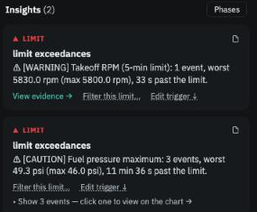
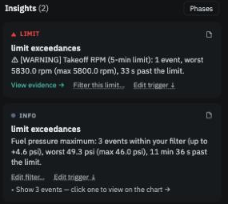

# From an insight to a decision

*Ten minutes. This follows one real case: a fuel-pressure limit that is exceeded on most flights because of the installation, and what to do about it so it stops burying everything else.*

## 1. Notice the pattern

On the Flights page, nearly every flight carries a *LIMIT* badge. Open one and the insight reads:

> ⚠ [CAUTION] Fuel pressure maximum: 3 events, worst 49.3 psi (max 46.0 psi), 11 min 36 s past the limit.

<figure class="screenshot" markdown>
{ .screenshot }
<figcaption>The insights column: a takeoff-RPM overshoot and a fuel-pressure excursion.</figcaption>
</figure>

A limit crossed once is worth a look. A limit crossed on 48 of 58 flights by about the same margin is a characteristic of this aircraft, and the question becomes: *do I understand it, and do I accept it?* In this case the fuel-pressure sender reads a few psi high, confirmed against a gauge at the annual. That is a reason — and the app wants the reason written down.

## 2. Open the filter editor

Click **Filter this limit…** on the insight (or on the event's row in the Events table). The editor opens in place and starts by telling you what it knows:

> *On the 48 of your flights that went past this limit, it typically went 3.3 psi past, at most 4.6 psi.*

<figure class="screenshot" markdown>
{ .screenshot }
<figcaption>The filter editor: magnitude, duration, phases, and the reason.</figcaption>
</figure>

## 3. Choose what to tolerate

Three conditions, any one of which tolerates an event:

- **A little past the limit is fine, up to** — the app suggests the worst you have seen, 4.6 psi, which with the 46 psi limit means readings up to 50.6 psi. Set it to what you actually accept.
- **Brief events are fine, lasting up to** — leave unticked here; duration is not the issue.
- **Events in these phases are fine** — leave unticked; this excursion happens in cruise, where it matters most.

Write the reason in **Why is this fine on your aircraft?** It appears in the Journal and in any export you share.

## 4. Preview, then apply

Click **Preview**. The app counts the effect across the whole workspace before anything changes:

> *This would hide 175 events on 48 of 58 flights; no flight would show a breach.*

That last part is the check that the band is wide enough for the pattern you know, and no wider. Then **Apply to all flights** — and note the caption above it: *All flights in this workspace — this limit*. A filter is a statement about your aircraft, not about one flight.

## 5. What changes

On every Flight view, those fuel-pressure events collapse into one line — *N events within your filter, up to +4.6 psi* — expandable if you want them. The *LIMIT* badges those flights carried only for this reason disappear from the Flights page, and the insights that remain are the ones that are new.

<figure class="screenshot" markdown>
{ .screenshot }
<figcaption>The same flight afterwards: the fuel-pressure events are within your filter, labelled INFO.</figcaption>
</figure>

What does **not** change: the Operators Manual limit still reads 46 psi, the events are still detected and still appear on the Trends page's *Limit: fuel press max* panel, and the app has frozen a reference of your twenty most recent flights with this event.

## 6. What the app keeps watching

Open the **Journal**. The filter is listed with its status — *Stable* to begin with — and a live count of what it is doing. From now on every new flight is compared with the frozen reference. If the sender starts reading five psi high instead of three, or events become more frequent, the status changes to **Drifting**; an event the band does not cover shows as a **Breach**; after 50 engine hours it asks for a **Review**. Each of these is counted on the Journal badge in the top bar and announced in a banner on the Flights page, so a filter never becomes a blind spot.

<figure class="screenshot" markdown>
{ .screenshot }
<figcaption>Journal → Limit filters: status, how far past the limit each flight went, time past the limit, and the frozen reference.</figcaption>
</figure>

## The other decisions

The same shape — see the effect, state the scope, record it in the Journal — applies to the rest:

- **Edit trigger** on an insight, or **Edit rules…** on any topic card, opens the rule editor beside the card. Change how many flights a comparison needs or how strong a trend must be; a live preview counts how many flights would gain or lose an insight; *Apply to all flights*.
- **Exclude this flight from reference** on an insight, or the flight's header: give a reason and the flight stops shaping what others are compared against. *This flight only.*
- **Enable/disable** a topic in the rule editor: the card stays on every flight, collapsed, with *Enable*.

All of them are explained on [Your decisions](../concepts/your-decisions.md). **Next:** [Export and import](export-import.md).
