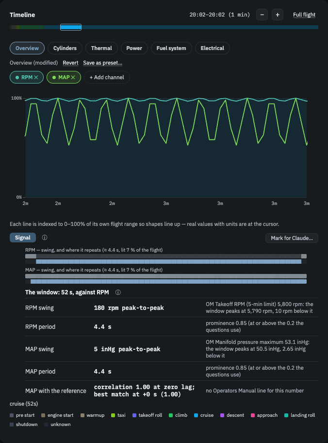
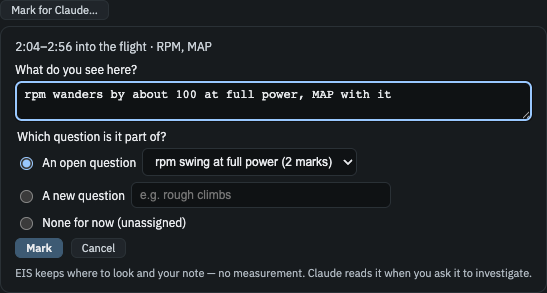

# Mark something for Claude

*Five minutes. Find something odd on a flight, mark it with a sentence under a question, and hand the question to Claude. Marking works on the website and on your computer; handing it to Claude needs the [extension installed](install-extension.md).*

## 1. Open the flight and turn on Signal

Open the flight on **Flights**. Under the chart, press **Signal**. Under each channel a strip shows how far it swings, second by second, and below it where it repeats — lit where a period stands out, with the period in the line above (*RPM — swing, and where it repeats (≈ 3.8 s, lit 10 % of the flight)*).

## 2. Zoom to what looks odd

Drag across the chart to the stretch you mean. With Signal on, its numbers appear under the chart: the swing beside the Operators Manual line it approaches, the period, and how the other channels move with the first.

{ .screenshot }

## 3. Mark for Claude

Press **Mark for Claude…** beside Signal. Write what you see, in your words — *rpm wanders by about 100 at full power, MAP with it*. Then choose the question it belongs to:

- **an open question** — the newest is chosen; marks of the same thing on other flights belong together;
- **a new question** — give it a short title (*rough climbs*);
- **none for now** — it waits under *Unassigned*.

Press **Mark**. The line beside the button says where it went: *Marked 10:16–11:02 under “rough climbs” (1 mark) in Research → Inbox.*

{ .screenshot }

## 4. Mark it again, elsewhere

If you have seen it on other flights, mark those windows under the same question. Two or three marks tell Claude more than one.

## 5. Find it in the inbox

**Research** in the top bar: your question is in the inbox, with its marks. A mark opens its flight at the window, with the channels you were looking at. Rename the question, edit a note, move a mark to another question, or delete one.

## 6. Hand it to Claude

In Claude Desktop, open a new chat, press **+**, choose **Investigate**, and send it with no text: Claude takes your newest open question, opens a notebook with your marks — your note, then a log view of each window — and starts from what you saw. To pick another question, type its title. The question shows *investigating* in the inbox, and *Open the investigation* takes you to the notebook ([Your first investigation](first-investigation.md)).

On the website, the inbox says the question is waiting for Claude and how to install the extension.

## Where to go next

- [Investigations](../concepts/research-investigations.md) — what Claude does with a question.
- [What EIS measures](../reference/what-eis-measures.md) — what the Signal strips and numbers are.
